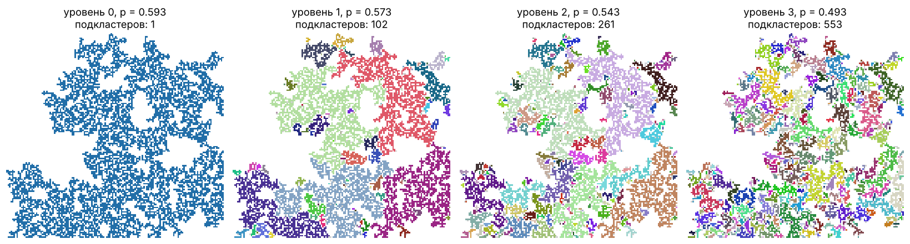
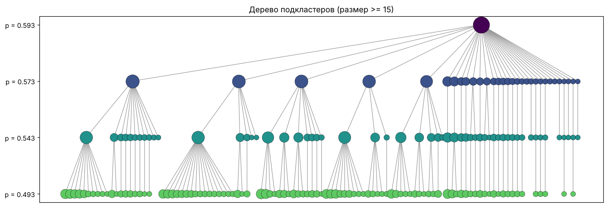
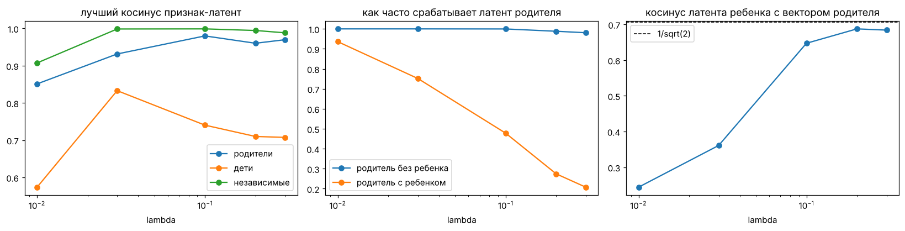
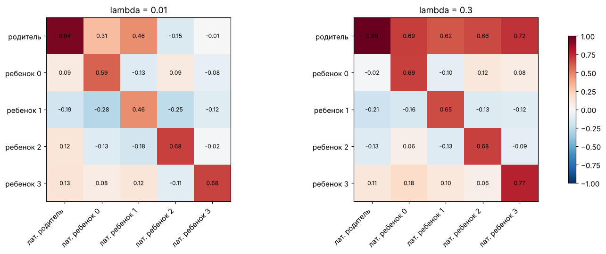

# Синтетические данные с иерархией признаков для проверки интерпретируемости

Чтобы проверять инструменты интерпретируемости (SAE и т.п.), нужны данные, в которых заранее известно, какие признаки там есть. Обычные игрушечные датасеты для этого слишком простые: признаки в них независимые, а в реальных данных понятия вложены друг в друга (животное -> собака -> такса).

Здесь две части:

1. как получить данные с известной иерархией признаков (из критической перколяции)
2. что на таких данных видно про SAE (поглощение признаков)

## 1. Иерархия признаков из критической перколяции

`01_percolation_hierarchy.ipynb`

На пороге перколяции есть кластеры любых размеров, а если понижать p на том же случайном поле, каждый кластер распадается на подкластеры. Кластер = признак, подкластер = признак-ребенок.



- фазовый переход около p_c = 0.5927
- размеры кластеров на пороге: n(s) ~ s^(-tau), получилось tau = 2.06 (теория 187/91 = 2.055)
- фрактальная размерность самого большого кластера: D = 1.91 (теория 91/48 = 1.896)
- дерево подкластеров на 4 уровнях p



- датасет: 20000 примеров, около 1300 признаков. Пример = клетка решетки, активные признаки = кластеры, в которые она попадает. Ребенок никогда не активен без родителя, признаки одного уровня не пересекаются.

## 2. Поглощение признаков в SAE

`02_sae_absorption.ipynb`

SAE (на numpy, градиенты руками, Adam) обучается на данных с признаками-родителями и признаками-детьми, плюс независимые признаки для контроля. 56 признаков в 48 измерениях, то есть в суперпозиции.

По обычным метрикам SAE выглядит хорошо: реконструкция почти идеальная, L0 близко к настоящему числу признаков. Но при сильном L1:

- латент родителя перестает срабатывать, когда рядом есть ребенок (срабатывает только в 20-30% таких случаев)
- латенты детей поворачиваются к направлению родителя, косинус почти 1/sqrt(2)

То есть родитель "поглощен" детьми (feature absorption). Независимые признаки находятся нормально.





Почему: если активны родитель p и ребенок c, то x = p + c. Два латента дают L1 = 2, один латент с направлением (p + c)/|p + c| дает L1 = sqrt(2). Реконструкция одинаковая, а штраф меньше. Поглощение растет с lambda и с P(ребенок | родитель).

## Запуск

```
pip install -r requirements.txt
jupyter notebook
```

Или открыть ноутбуки в Google Colab. Первый считается меньше минуты, второй около двух минут на CPU.

## Дальше

- обучить SAE на признаках из перколяции (часть 1) вместо простого дерева: там иерархия глубже и размеры с тяжелыми хвостами
- проверить Matryoshka SAE и TopK SAE
- амплитуды признаков не только 0/1
- 3D решетка, другие шаги по p
